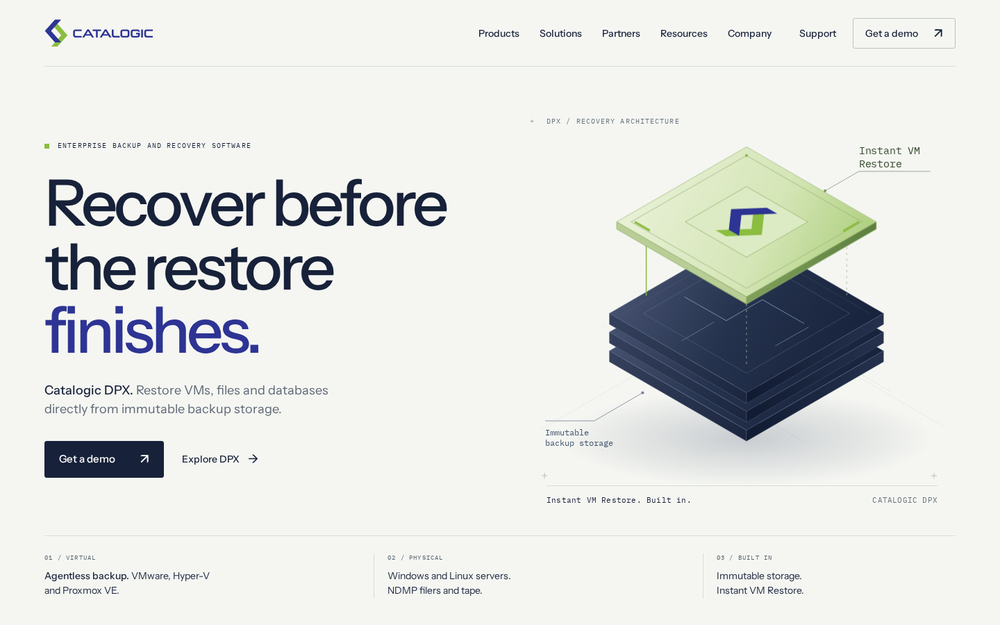
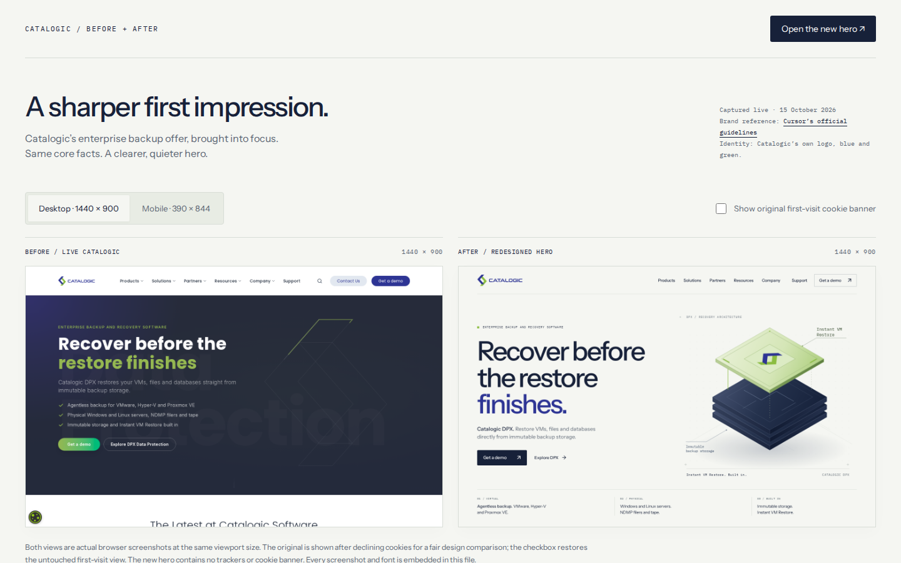
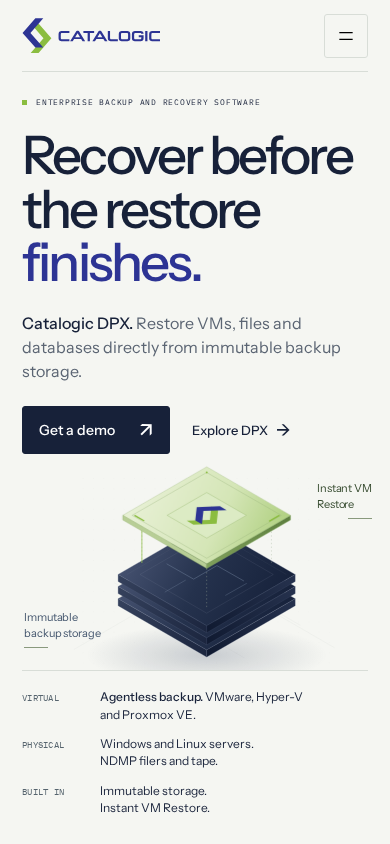
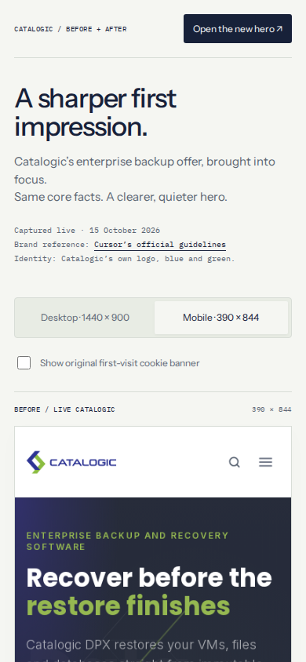

# Public access proof

- **Observed:** the [hero](https://av.github.io/catalogic-hero/) and [comparison](https://av.github.io/catalogic-hero/catalogic-hero-compare.html) returned HTTP 200 in four fresh, logged-out Chromium contexts on a standard GitHub-hosted Linux runner. No cookies or authorization headers were sent.
- **Observed:** desktop 1440 × 900 and mobile 390 × 844 screenshots are below. Every embedded font loaded; every image loaded, including all desktop/mobile and cookie-banner states in the comparison. There were no failed requests, JavaScript errors or horizontal overflow.
- **Observed:** each page made exactly one HTTPS request, to `av.github.io`. No request targeted a private host. Server IPs and DNS addresses were public. The runner had no Tailscale interface or tailnet route; the workflow does not configure a VPN. **Inferred:** this is an independent check outside Ivan's tailnet, and the public HTTPS URLs are shareable from normal internet connections.
- **Observed:** [source audit](source-audit.json) confirms both original HTML files are byte-identical, use embedded assets and contain no private-host references or common credential patterns. The root index is an identical hero alias. No design changes.
- **Observed:** [Pages settings](pages-settings.json) show public hosting, enforced HTTPS, no custom domain, and publication from `/docs` on `main`. The verification workflow is manual, with no schedule. **Inferred:** no routine server, domain-renewal or application-dependency upkeep is required. Availability remains dependent on GitHub Pages and the GitHub account.

The browser run completed **2026-10-15 21:43:38 UTC**, or **23:43:38 Warsaw**, before the 2026-10-16 02:00 Warsaw deadline. These proof files are committed to the public repository; the deliverables and proof links do not depend on an expiring Actions artifact.

Full evidence: [request, asset and network report](public-verification.json). [Successful external browser run](https://github.com/av/catalogic-hero/actions/runs/38811955797).

## Desktop screenshots

### Hero — 1440 × 900

### Comparison — 1440 × 900

## Mobile screenshots

### Hero — 390 × 844

### Comparison — 390 × 844

